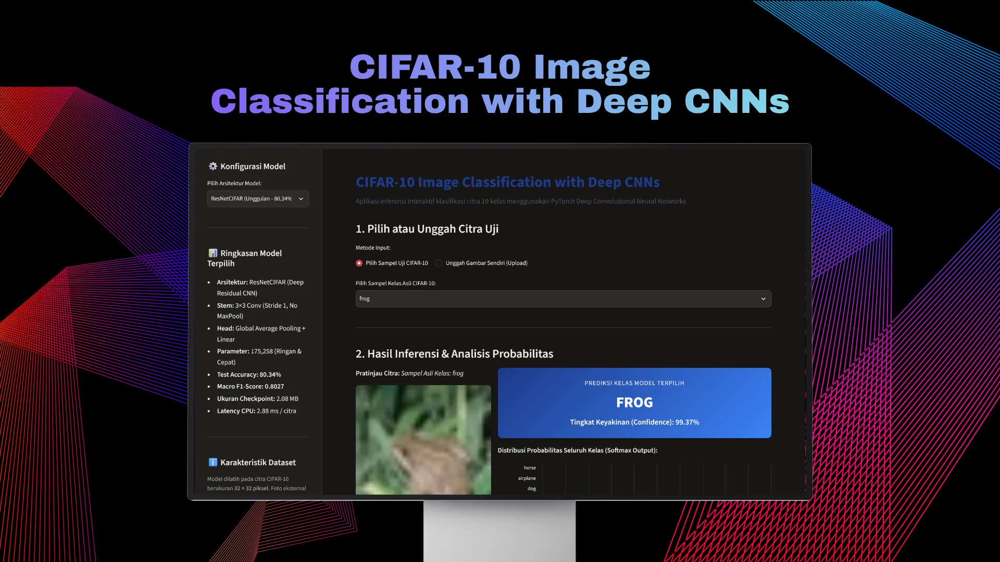
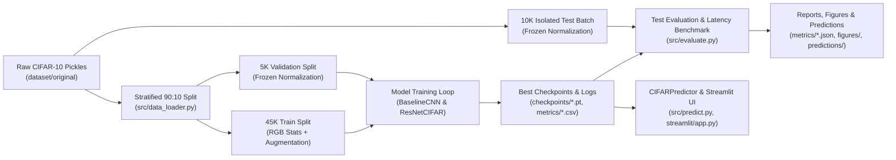
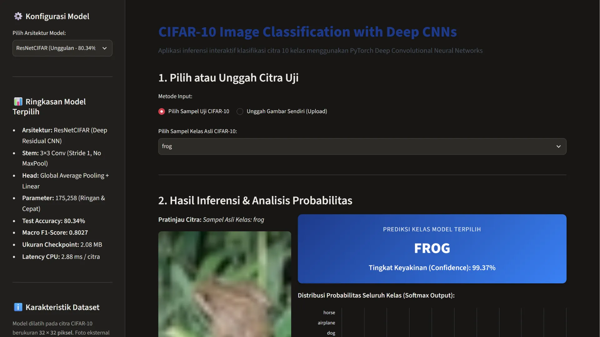
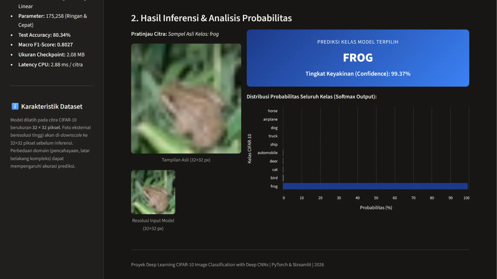
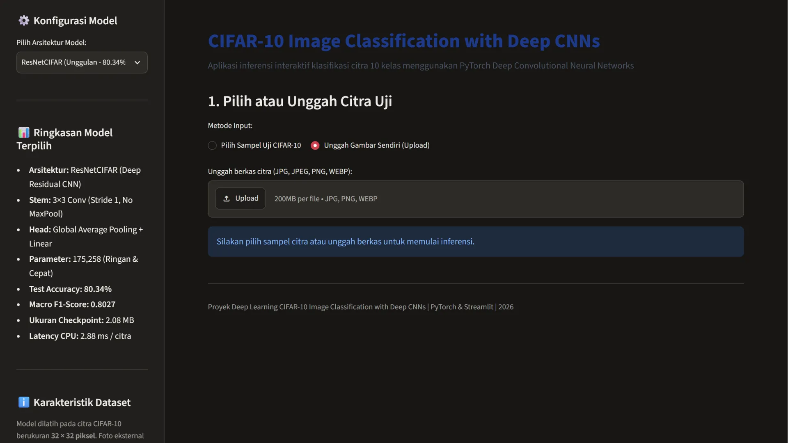
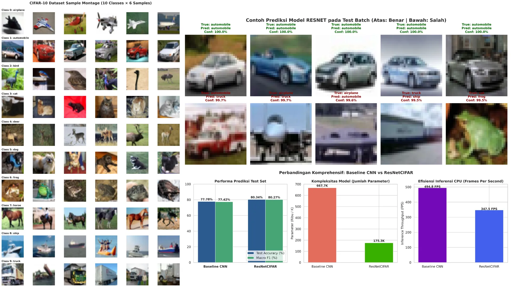
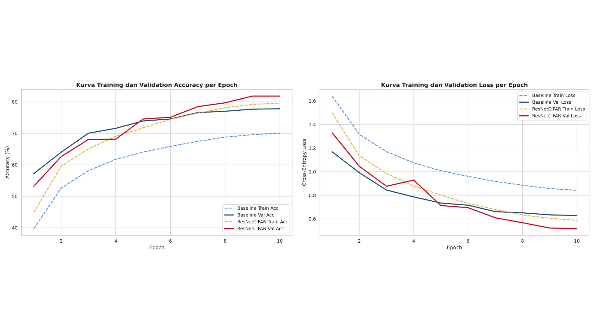
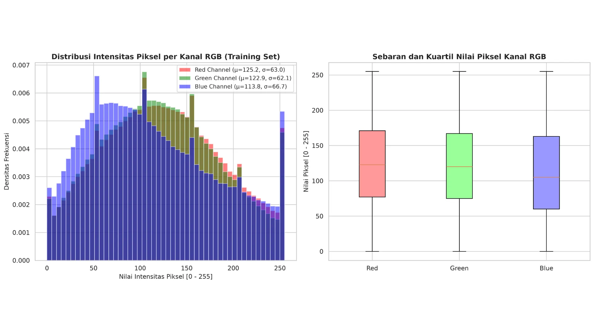
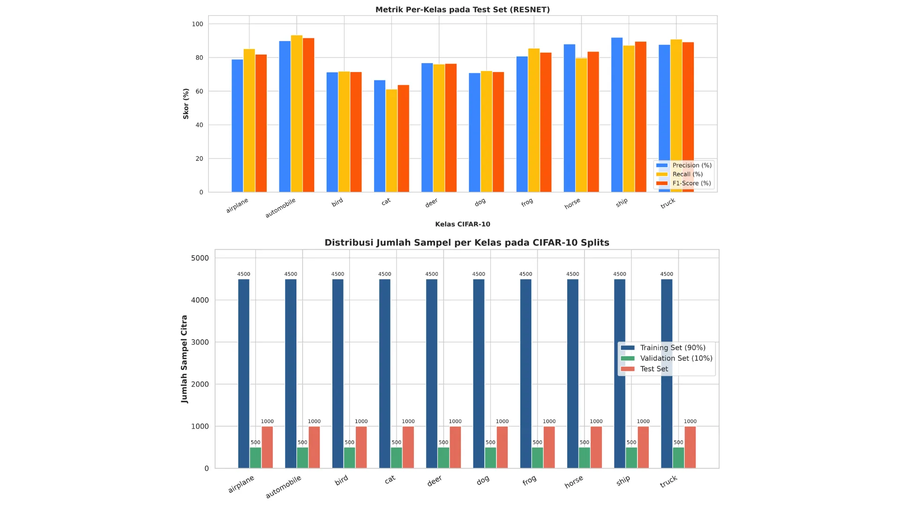
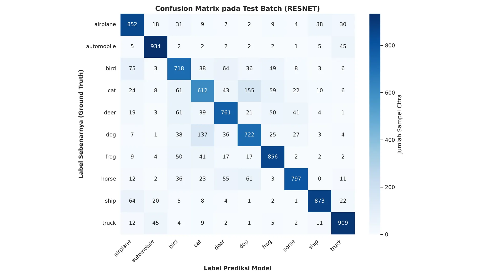

# CIFAR-10 Image Classification with Deep CNNs




## Project Overview

This project designs, trains, evaluates, and compares convolutional neural network architectures in PyTorch for 10-class image classification on the CIFAR-10 benchmark dataset. It contrasts a 3-stage VGG-style `BaselineCNN` (667,690 parameters) against a custom `ResNetCIFAR` architecture (175,258 parameters) tailored for 32 × 32 RGB imagery through a CIFAR-specific stem, residual skip connections, and Global Average Pooling. Alongside modular training, evaluation, and plotting pipelines, the repository includes an interactive Streamlit inference application for real-time classification of CIFAR-10 test samples and uploaded images.

## Problem Statement & Objectives

Classifying 32 × 32 low-resolution natural images across heterogeneous categories requires preserving fine spatial structure in early layers while preventing gradient degradation and dense-head overfitting in deeper networks. Standard ImageNet-style downsampling stems aggressively compress spatial grids too early, whereas traditional stacked CNNs with large fully connected heads concentrate parameters in dense layers prone to memorization.

- Build a modular, leak-free PyTorch pipeline covering raw CIFAR-10 binary ingestion, stratified splitting, training, and single-pass test evaluation.
- Compare a sequential VGG-style `BaselineCNN` against a residual `ResNetCIFAR` architecture on classification accuracy, Macro F1-score, parameter efficiency, and CPU inference throughput.
- Prevent data leakage by isolating `test_batch`, performing stratified 90:10 splitting before preprocessing, and computing channel-wise RGB normalization statistics strictly on the 45,000-image training split.
- Analyze per-class performance, confusion patterns, and high-confidence misclassifications across all 10 object and animal classes.
- Provide publication-ready diagnostic plots and an interactive Streamlit web application for side-by-side model inference.

## Data & Input Sources

The project uses the local CIFAR-10 dataset stored in [dataset/original/](dataset/original/) in Python Pickle binary format (`batches.meta`, `data_batch_1` through `data_batch_5`, and `test_batch`). Each sample is stored as a flattened 3,072-byte channel-first `uint8` vector (`[0, 255]`) representing 1,024 Red, 1,024 Green, and 1,024 Blue pixel values, reconstructed into `(32, 32, 3)` RGB images across 10 balanced classes: `airplane`, `automobile`, `bird`, `cat`, `deer`, `dog`, `frog`, `horse`, `ship`, and `truck`. Data inspection via [src/eda_and_inspection.py](src/eda_and_inspection.py) and [metrics/eda_summary.json](metrics/eda_summary.json) confirmed zero `NaN` values and zero duplicate images across the 50,000 raw training samples.

| Attribute | Description |
|---|---|
| Dataset / Input Source | CIFAR-10 Local Binary Pickle Batches (`dataset/original/`) |
| Source | [dataset/original/](dataset/original/) (`batches.meta`, `data_batch_1`–`data_batch_5`, `test_batch`) |
| Format | Python Pickle (`uint8` flattened 3,072-element vectors reshaped to `32 × 32 × 3` RGB) |
| Samples / Records | 60,000 total images: 45,000 train, 5,000 validation (90:10 stratified), 10,000 test |
| Features / Input Shape | `(3, 32, 32)` normalized `float32` RGB tensors (scaled from `[0, 255]`) |
| Target / Label | 10 mutually exclusive classes (5,000 train+val and 1,000 test samples per class) |

## Data Preprocessing & Feature Engineering

Data ingestion and transformation are implemented in [src/data_loader.py](src/data_loader.py) and [src/dataset.py](src/dataset.py) with strict separation between training and evaluation pipelines so validation and test splits never influence normalization statistics or receive stochastic augmentation.

| Stage | Transformation | Input | Output |
|---|---|---|---|
| Tensor Reconstruction | Reshape & transpose channel-first vectors | `(N, 3072)` `uint8` array | `(N, 32, 32, 3)` RGB `uint8` images |
| Stratified Splitting | `train_test_split(..., stratify=labels, random_state=42)` | 50,000 labeled images | 45,000 train / 5,000 validation |
| Channel Statistics | Per-channel mean & std on `[0, 1]` train split only | 45,000 train images | Mean `[0.49113, 0.48211, 0.44645]`, Std `[0.24687, 0.24343, 0.26160]` |
| Train Augmentation | `RandomCrop(32, padding=4, padding_mode='reflect')` + `RandomHorizontalFlip(p=0.5)` | `32 × 32` PIL image | Augmented `32 × 32` PIL image |
| Standardization | `ToTensor()` + `Normalize(mean, std)` | PIL image (`[0, 255]`) | Normalized `(3, 32, 32)` `float32` tensor |

1. Load `batches.meta`, `data_batch_1` through `data_batch_5`, and `test_batch` with `pickle.load(..., encoding='bytes')` and reshape raw vectors into HWC `(32, 32, 3)` arrays.
2. Split the 50,000 training images into 45,000 training and 5,000 validation samples using a fixed `random_state=42` stratified by class label (4,500 train / 500 val per class).
3. Compute RGB channel mean and standard deviation exclusively from the 45,000 training images and persist them to [metrics/normalization_stats.json](metrics/normalization_stats.json).
4. Apply reflection-padded random cropping and horizontal flipping only during training iterations, while validation and test pipelines apply deterministic `ToTensor()` and `Normalize()` transforms.

## Tech Stack

| Category | Technology | Purpose |
|---|---|---|
| Programming Language | Python | Core implementation across data, modeling, evaluation, and UI modules |
| Deep Learning Framework | PyTorch | Neural network layers, autograd, `AdamW`, `CosineAnnealingLR`, and checkpointing |
| Vision Utilities | Torchvision | Image transformation pipelines (`RandomCrop`, `RandomHorizontalFlip`, `Normalize`) |
| Numerical & Data Processing | NumPy, Pandas | Tensor reshaping, normalization stats, CSV training logs, and classification reports |
| Evaluation & Splitting | Scikit-Learn | Stratified train-validation splitting, confusion matrix, and per-class metrics |
| Image Processing | Pillow | PIL image conversion, resizing to `32 × 32`, and uploaded file decoding |
| Visualization | Matplotlib, Seaborn, Altair | Static evaluation plots in `figures/` and interactive probability charts in Streamlit |
| Interactive Interface | Streamlit | Web UI for switching models, testing CIFAR-10 samples, and uploading custom images |
| Experiment Notebook | Jupyter Notebook (`nbformat`) | End-to-end interactive workflow in [notebooks/cifar10_deep_cnn.ipynb](notebooks/cifar10_deep_cnn.ipynb) |

## Machine Learning Approach

The project addresses multi-class image classification using deep supervised representation learning over low-resolution RGB grids. Rather than hand-crafted descriptors or flattening raw pixels into dense networks, convolutional inductive biases (weight sharing and translation equivariance) extract hierarchical edges, textures, and object silhouettes end-to-end under Cross-Entropy optimization.

| Attribute | Details |
|---|---|
| Learning Paradigm | Deep Learning (Supervised Multi-Class Image Classification) |
| Problem Domain | Computer Vision — Low-Resolution Natural Image Recognition |
| ML Task | 10-Class Image Classification |
| Input Representation | Normalized `(3, 32, 32)` RGB `float32` tensors |
| Target Output | Discrete class index `0–9` and 10-way Softmax probability distribution |
| Comparative Strategy | Sequential VGG-style `BaselineCNN` vs. residual `ResNetCIFAR` trained under identical data splits and schedules |

## Model Overview

Two convolutional neural network architectures are implemented in [src/models.py](src/models.py) and trained from scratch without external pretrained weights. `BaselineCNN` serves as a classic stacked convolutional benchmark with spatial `MaxPool2d` downsampling and a heavy dense classifier, while `ResNetCIFAR` adapts the CIFAR-10 residual design (He et al., 2016) with a stride-1 stem, three residual stages, and Global Average Pooling.

| Attribute | BaselineCNN | ResNetCIFAR (Primary Model) |
|---|---|---|
| Architecture Family | 3-Stage VGG-style Sequential CNN | Custom Deep Residual Network (3 Stages, 2 `ResidualBlock`s/Stage) |
| Input Stem | `Conv2d(3→32, 3×3)` + `BatchNorm2d` + `ReLU` | `Conv2d(3→16, 3×3, stride=1, padding=1)` + `BatchNorm2d` + `ReLU` (No MaxPool) |
| Feature Extraction | 3 Conv-BN-ReLU blocks (`32→64→128`) with `MaxPool2d(2,2)` & `Dropout2d` | Stage 1 (`16 ch, 32×32`), Stage 2 (`32 ch, 16×16`), Stage 3 (`64 ch, 8×8`) with `1×1` projection shortcuts |
| Classification Head | `Flatten(2048)` → `Linear(2048,256)` → `BN1d` → `ReLU` → `Dropout(0.4)` → `Linear(256,10)` | `AdaptiveAvgPool2d((1,1))` → `Flatten(64)` → `Dropout(0.2)` → `Linear(64,10)` |
| Total Parameters | 667,690 (all trainable) | 175,258 (all trainable — 73.75% fewer parameters) |
| Checkpoint Size | 7.68 MB ([checkpoints/baseline_best.pt](checkpoints/baseline_best.pt)) | 2.08 MB ([checkpoints/resnet_best.pt](checkpoints/resnet_best.pt)) |
| Pretrained Status | Trained from scratch on CIFAR-10 | Trained from scratch on CIFAR-10 |

## ML Workflow

1. **Data Inspection & EDA** ([src/eda_and_inspection.py](src/eda_and_inspection.py)): Verify all raw binary batches in [dataset/original/](dataset/original/), check value ranges and duplicates, compute training-only normalization stats, and generate exploratory figures (`dataset_samples.png`, `class_distribution.png`, `rgb_pixel_distribution.png`) plus [metrics/eda_summary.json](metrics/eda_summary.json).
2. **Stratified Splitting & Augmentation** ([src/data_loader.py](src/data_loader.py), [src/dataset.py](src/dataset.py)): Construct a 90:10 stratified split (`random_state=42`) and wrap splits in `CIFAR10Dataset` with train-only `RandomCrop` and `RandomHorizontalFlip`.
3. **Dual-Model Training** ([src/train.py](src/train.py)): Train `BaselineCNN` and `ResNetCIFAR` for 10 epochs using `AdamW`, `CosineAnnealingLR`, and `CrossEntropyLoss`, logging per-epoch history to [metrics/baseline_history.csv](metrics/baseline_history.csv) and [metrics/resnet_history.csv](metrics/resnet_history.csv) while saving best-validation checkpoints.
4. **Independent Test Evaluation** ([src/evaluate.py](src/evaluate.py)): Evaluate best checkpoints once on the isolated 10,000-image `test_batch` to compute test accuracy, loss, per-class precision/recall/F1, confusion matrices, single-image CPU latency/FPS over 1,000 samples, and top correct/error prediction samples in [predictions/](predictions/).
5. **Diagnostic Plotting & Reporting** ([src/plot_results.py](src/plot_results.py), [final_report.md](final_report.md)): Generate comparative learning curves, model comparison charts, confusion matrix heatmaps, per-class bar charts, and error-case galleries in [figures/](figures/).
6. **Interactive Inference Application** ([src/predict.py](src/predict.py), [streamlit/app.py](streamlit/app.py)): Serve both trained checkpoints in a Streamlit web interface for interactive sample testing, image uploads, and Softmax probability visualization.

## ML Pipeline Architecture

The end-to-end architecture separates raw data ingestion and training-split statistics calculation from model training, single-pass test evaluation, artifact serialization, and interactive Streamlit inference.



## Model Training & Configuration

Both `BaselineCNN` and `ResNetCIFAR` were trained from scratch on CPU (`torch.set_num_threads(12)`) for 10 epochs with deterministic seeding (`random_seed=42`). Learning rate scheduling followed `CosineAnnealingLR` decaying from `1e-3` to `1e-5`, and model checkpoints were saved strictly when validation accuracy reached a new maximum (`Best Validation Accuracy`: `77.80%` at Epoch 10 for `BaselineCNN` over 14.80 minutes; `81.84%` at Epoch 9 for `ResNetCIFAR` over 17.27 minutes).

| Parameter / Setting | Verified Value | Role in Training |
|---|---|---|
| Loss Function | `nn.CrossEntropyLoss()` | Multi-class classification objective over 10 mutually exclusive logits |
| Optimizer | `torch.optim.AdamW` | Adaptive moment estimation with decoupled L2 regularization |
| Initial Learning Rate | `0.001` (`1e-3`) | Starting step size for stable convergence |
| Weight Decay | `0.0001` (`1e-4`) | Decoupled regularization against weight magnitude growth |
| LR Scheduler | `CosineAnnealingLR` (`T_max=10`, `eta_min=1e-5`) | Smooth cosine learning rate decay down to `3.4e-5` logged at Epoch 10 |
| Batch Size | `128` | Mini-batch size for train, validation, and test `DataLoader`s (`num_workers=0`) |
| Epochs Executed | `10` | Completed 10-epoch schedule logged in `metrics/*_history.csv` |
| Validation Split | `0.1` (`10%`, stratified) | 45,000 training images / 5,000 validation images |
| Random Seed | `42` | Applied to NumPy, PyTorch, and stratified split |
| Checkpoint Criterion | Best Validation Accuracy | Exports `model_state_dict`, optimizer state, stats, and hyperparameters |

```bash
python src/train.py --model baseline --epochs 10 --batch_size 128 --lr 0.001
python src/train.py --model resnet --epochs 10 --batch_size 128 --lr 0.001
```

## Model Comparison & Selection

Evaluating both architectures under identical preprocessing, splits, and optimization hyperparameters demonstrates that `ResNetCIFAR` outperforms `BaselineCNN` across all accuracy and F1 benchmarks while reducing parameter count by `73.75%` and checkpoint size by `72.92%`. Although `BaselineCNN` achieves lower per-image CPU latency (`2.021 ms` vs. `2.877 ms`) due to shallower sequential kernel calls, `ResNetCIFAR` still sustains `347.5 FPS` on CPU and is selected as the primary model.

| Metric | BaselineCNN | ResNetCIFAR (Selected) | Difference |
|---|---|---|---|
| Best Validation Accuracy | 77.80% (Epoch 10) | **81.84%** (Epochs 9–10) | +4.04% |
| Test Accuracy (`test_batch`) | 77.78% | **80.34%** | +2.56% |
| Test Loss (Cross-Entropy) | 0.6399 | **0.5621** | -0.0778 |
| Macro Avg F1-Score | 0.7742 | **0.8027** | +0.0285 |
| Weighted Avg F1-Score | 0.7742 | **0.8027** | +0.0285 |
| Total Parameters | 667,690 | **175,258** | -73.75% |
| Checkpoint Disk Size | 7.68 MB | **2.08 MB** | -72.92% |
| CPU Latency (1,000-sample bench) | **2.021 ms/image** | 2.877 ms/image | +0.856 ms |
| CPU Throughput | **494.8 FPS** | 347.5 FPS | -147.3 FPS |

## Model Artifacts & Checkpoints

All serialized PyTorch weights, normalization statistics, training logs, evaluation JSON/CSV summaries, and top prediction records are stored directly in the repository for inspection and inference.

| Artifact | Format | Purpose | Repository Path |
|---|---|---|---|
| `resnet_best.pt` | PyTorch Checkpoint (`.pt`) | Best `ResNetCIFAR` weights, optimizer state, class names, and train mean/std | [checkpoints/resnet_best.pt](checkpoints/resnet_best.pt) |
| `baseline_best.pt` | PyTorch Checkpoint (`.pt`) | Best `BaselineCNN` weights, optimizer state, class names, and train mean/std | [checkpoints/baseline_best.pt](checkpoints/baseline_best.pt) |
| `normalization_stats.json` | JSON | Training-split RGB channel mean, standard deviation, and class ordering | [metrics/normalization_stats.json](metrics/normalization_stats.json) |
| `resnet_history.csv` / `baseline_history.csv` | CSV | Epoch-by-epoch train/val loss, accuracy, learning rate, and epoch duration | [metrics/resnet_history.csv](metrics/resnet_history.csv) |
| `resnet_eval.json` / `baseline_eval.json` | JSON | Full test-set metrics, per-class scores, confusion matrix, and CPU FPS | [metrics/resnet_eval.json](metrics/resnet_eval.json) |
| `resnet_predictions.json` / `baseline_predictions.json` | JSON | Top-15 highest-confidence correct and misclassified test samples | [predictions/resnet_predictions.json](predictions/resnet_predictions.json) |

## Model Evaluation & Results

Final testing was performed once on the isolated 10,000-image `test_batch` using [src/evaluate.py](src/evaluate.py), with full results recorded in [metrics/resnet_eval.json](metrics/resnet_eval.json) and [metrics/resnet_classification_report.csv](metrics/resnet_classification_report.csv). `ResNetCIFAR` achieved `80.34%` test accuracy (`0.5621` Cross-Entropy loss) and `0.8027` Macro/Weighted F1-score, improving cleanly over its validation progression (`81.84%` best val accuracy at Epoch 9) with no signs of severe overfitting.

| Class | Precision | Recall | F1-Score | Support |
|---|---:|---:|---:|---:|
| `airplane` | 78.96% | 85.20% | 81.96% | 1,000 |
| `automobile` | 89.98% | 93.40% | **91.66%** | 1,000 |
| `bird` | 71.37% | 71.80% | 71.59% | 1,000 |
| `cat` | 66.67% | 61.20% | 63.82% | 1,000 |
| `deer` | 76.79% | 76.10% | 76.44% | 1,000 |
| `dog` | 70.92% | 72.20% | 71.56% | 1,000 |
| `frog` | 80.75% | 85.60% | 83.11% | 1,000 |
| `horse` | 88.07% | 79.70% | 83.67% | 1,000 |
| `ship` | **91.99%** | 87.30% | 89.58% | 1,000 |
| `truck` | 87.74% | 90.90% | 89.29% | 1,000 |

- **Strongest Categories**: Rigid man-made vehicles achieve the highest F1-scores—`automobile` (`91.66%`), `ship` (`89.58%`), and `truck` (`89.29%`)—supported by clear geometric silhouettes and background contrast.
- **Primary Confusion Pairs**: Biological quadrupeds exhibit the highest mutual confusion on `32 × 32` grids: `155` `cat` images were misclassified as `dog` and `137` `dog` images as `cat`, making `cat` (`63.82%` F1) and `dog` (`71.56%` F1) the hardest classes.
- **Secondary Overlaps**: Shared sky/water contexts and boxy silhouettes led to smaller cross-confusions such as `bird` → `airplane` (`75`), `ship` → `airplane` (`64`), `bird` → `deer` (`64`), and symmetric `truck` ↔ `automobile` (`45` each).
- **Known Limitations**: Training on a 12-thread CPU capped runs at 10 epochs without GPU acceleration, and the native `32 × 32` resolution restricts micro-texture discrimination needed to separate visually similar animal species.

## Results Visualization & Preview

### 1. Streamlit Interactive Inference Interface — Model Overview & Prediction Card

Top view of the Streamlit inference application configured with `ResNetCIFAR`, displaying model telemetry (`175,258` parameters, `80.34%` test accuracy, `0.8027` Macro F1-score, `2.08 MB` checkpoint, `2.88 ms` CPU latency) and predicting `FROG` with `99.37%` confidence on a CIFAR-10 `test_batch` sample.

### 2. Streamlit Interactive Inference Interface — Input Resolution & Softmax Probabilities

Lower panel of the Streamlit interface comparing the enlarged display preview against the exact `32 × 32 px` model input tensor alongside an interactive Altair bar chart showing the 10-class Softmax probability distribution concentrated overwhelmingly on `frog`.

### 3. Streamlit Interactive Inference Interface — Custom Image Upload Mode

Upload workflow in the Streamlit web app allowing users to drag and drop external `JPG`, `JPEG`, `PNG`, or `WEBP` images (up to 200 MB) for automatic `32 × 32` resizing, training-stat normalization, and live classification.

### 4. Dataset Sample Montage, Test Prediction Examples & Model Comparison Dashboard

Composite diagnostic dashboard pairing the 10-class × 6-sample CIFAR-10 montage (left) with `ResNetCIFAR` test-batch sample predictions—five `100.0%`-confident `automobile` successes vs. five high-confidence misclassifications (top-right)—and the 3-panel comparison showing `ResNetCIFAR` outperforming `BaselineCNN` in accuracy (`80.34%` vs. `77.78%`) with `175.3K` vs. `667.7K` parameters at `347.5 FPS` vs. `494.8 FPS` (bottom-right).

### 5. Training & Validation Accuracy and Cross-Entropy Loss Curves (10 Epochs)

Ten-epoch convergence curves comparing `BaselineCNN` and `ResNetCIFAR` across training and validation splits, showing `ResNetCIFAR` steadily lowering validation loss to `0.5170` and reaching `81.84%` validation accuracy without overfitting divergence.

### 6. Training-Split RGB Pixel Intensity Histogram & Quartile Distribution

Pixel-intensity density histograms and quartile boxplots computed strictly on the 45,000-image training split, documenting channel distributions across `[0, 255]` (`Red`: μ=125.2, σ=63.0; `Green`: μ=122.9, σ=62.1; `Blue`: μ=113.8, σ=66.7) prior to z-score normalization.

### 7. ResNetCIFAR Per-Class Test Metrics & Stratified Dataset Split Balance

Per-class Precision, Recall, and F1-Score bars for `ResNetCIFAR` on `test_batch` (top), highlighting peak F1 on `automobile` (`91.66%`) and `ship` (`89.58%`) versus `cat` (`63.82%`), paired with verification of perfectly balanced class counts (`4,500` train / `500` validation / `1,000` test per class) (bottom).

### 8. ResNetCIFAR 10-Class Confusion Matrix on Test Batch

Confusion matrix across all 10,000 `test_batch` images illustrating strong diagonal recall on `automobile` (`934`), `truck` (`909`), `ship` (`873`), `frog` (`856`), and `airplane` (`852`), while pinpointing `cat` ↔ `dog` (`155` and `137` errors) as the dominant source of residual error.

## Prerequisites

- **Operating System**: Windows, Linux, or macOS.
- **Python**: Python 3.10 or newer recommended (uses standard library `pickle`, `json`, `argparse`).
- **Core ML & Data Libraries**: `torch>=2.0.0`, `torchvision>=0.15.0`, `numpy>=1.24.0`, `pandas>=2.0.0`, `scikit-learn>=1.2.0`, `pillow>=9.5.0`, `tqdm>=4.65.0` (listed in [requirements.txt](requirements.txt)).
- **Visualization & App Libraries**: `matplotlib>=3.7.0`, `seaborn>=0.12.0`, `altair>=5.0.0`, `streamlit>=1.30.0`, `nbformat>=5.9.0`.
- **Compute**: Multi-core CPU is fully supported (training and inference scripts automatically select CUDA if available, otherwise fall back to CPU with `torch.set_num_threads(12)`).
- **Local Dataset Files**: Raw CIFAR-10 Python Pickle files located in `dataset/original/` (already included in the repository).

## Installation & Setup

1. Clone the repository and enter the project directory:
   ```bash
   git clone https://github.com/weztcy/CIFAR-10-Image-Classification-with-Deep-CNNs.git
   cd "CIFAR-10 Image Classification with Deep CNNs"
   ```
2. Create and activate a Python virtual environment:
   ```bash
   python -m venv .venv
   # Windows PowerShell:
   .venv\Scripts\Activate.ps1
   # Linux/macOS:
   source .venv/bin/activate
   ```
3. Install all required Python dependencies from [requirements.txt](requirements.txt):
   ```bash
   pip install -r requirements.txt
   ```
4. Verify model initialization and dataset availability:
   ```bash
   python src/models.py
   ```

## Usage & Execution

Ensure your working directory is the repository root. Note that [src/eda_and_inspection.py](src/eda_and_inspection.py), [src/train.py](src/train.py), [src/evaluate.py](src/evaluate.py), [src/plot_results.py](src/plot_results.py), and [streamlit/app.py](streamlit/app.py) default to reading raw batches from `dataset/` and checkpoints/metrics from `outputs/checkpoints/`, `outputs/metrics/`, and `outputs/predictions/`, whereas pre-generated repository artifacts are stored under [dataset/original/](dataset/original/), [checkpoints/](checkpoints/), [metrics/](metrics/), and [predictions/](predictions/).

1. **Run the Interactive Streamlit Web App** (point `outputs/checkpoints` or copy `checkpoints/` and `dataset/original/*` as expected by `streamlit/app.py`):
   ```bash
   streamlit run streamlit/app.py
   ```
2. **Run Single-Image Inference via Python** ([src/predict.py](src/predict.py)):
   ```python
   from src.predict import CIFARPredictor

   predictor = CIFARPredictor(checkpoint_path="checkpoints/resnet_best.pt", model_type="resnet")
   top_class, confidence, all_probs = predictor.predict("path/to/image.png")
   print(f"Predicted: {top_class} ({confidence * 100:.2f}%)")
   ```
3. **Explore the Full Experiment Notebook**:
   ```bash
   jupyter notebook notebooks/cifar10_deep_cnn.ipynb
   ```

## Reproducibility & Execution

All experiments can be reproduced deterministically by fixing `random_seed=42` (`np.random.seed(42)`, `torch.manual_seed(42)`, `torch.backends.cudnn.deterministic = True`, and `train_test_split(..., random_state=42)`) across [src/data_loader.py](src/data_loader.py) and [src/train.py](src/train.py). Minor floating-point differences may still occur across different CPU/GPU hardware or PyTorch builds.

1. Run Exploratory Data Analysis and generate `eda_summary.json` and EDA figures (pass `data_dir='dataset/original'` and `metrics_dir='metrics'` when invoking `run_eda` directly, or place dataset files in `dataset/`):
   ```bash
   python -c "import sys; sys.path.append('src'); from eda_and_inspection import run_eda; run_eda(data_dir='dataset/original', output_dir='figures', metrics_dir='metrics')"
   ```
2. Train both models for 10 epochs with `batch_size=128`, `lr=0.001`, `weight_decay=1e-4`, and `random_seed=42`:
   ```bash
   python -c "import sys; sys.path.append('src'); from train import train_model; train_model('baseline', epochs=10, batch_size=128, lr=0.001, data_dir='dataset/original', checkpoints_dir='checkpoints', metrics_dir='metrics')"
   python -c "import sys; sys.path.append('src'); from train import train_model; train_model('resnet', epochs=10, batch_size=128, lr=0.001, data_dir='dataset/original', checkpoints_dir='checkpoints', metrics_dir='metrics')"
   ```
3. Evaluate both saved best checkpoints on `test_batch` and regenerate all evaluation JSON/CSV outputs and figures:
   ```bash
   python -c "import sys; sys.path.append('src'); from evaluate import evaluate_model_on_test; evaluate_model_on_test('baseline', data_dir='dataset/original', checkpoints_dir='checkpoints', metrics_dir='metrics', predictions_dir='predictions'); evaluate_model_on_test('resnet', data_dir='dataset/original', checkpoints_dir='checkpoints', metrics_dir='metrics', predictions_dir='predictions')"
   python -c "import sys; sys.path.append('src'); from plot_results import generate_all_plots; generate_all_plots(metrics_dir='metrics', predictions_dir='predictions', output_dir='figures', data_dir='dataset/original')"
   ```

## Contributing

Contributions are welcome to extend model architectures, augmentation pipelines, or evaluation diagnostics while preserving leak-free validation protocols.

1. Fork the repository.
2. Create a feature branch for your change (`git checkout -b feature/your-feature`).
3. Make your changes and update relevant documentation.
4. Run relevant checks or model/evaluation scripts to verify behavior (`python src/models.py`).
5. Commit and push your branch to your fork.
6. Open a pull request with a clear explanation of the changes and results.

## License

This project is licensed under the MIT License.
See the [LICENSE](LICENSE) file for details.

## Author & Contact

**Yohanes Dimas Pratama**

- GitHub: [github.com/weztcy](https://github.com/weztcy)
- Portfolio: [yohanesdimas.com](https://yohanesdimas.com)
- LinkedIn: [linkedin.com/in/yohanes-dimas](https://www.linkedin.com/in/yohanes-dimas)
