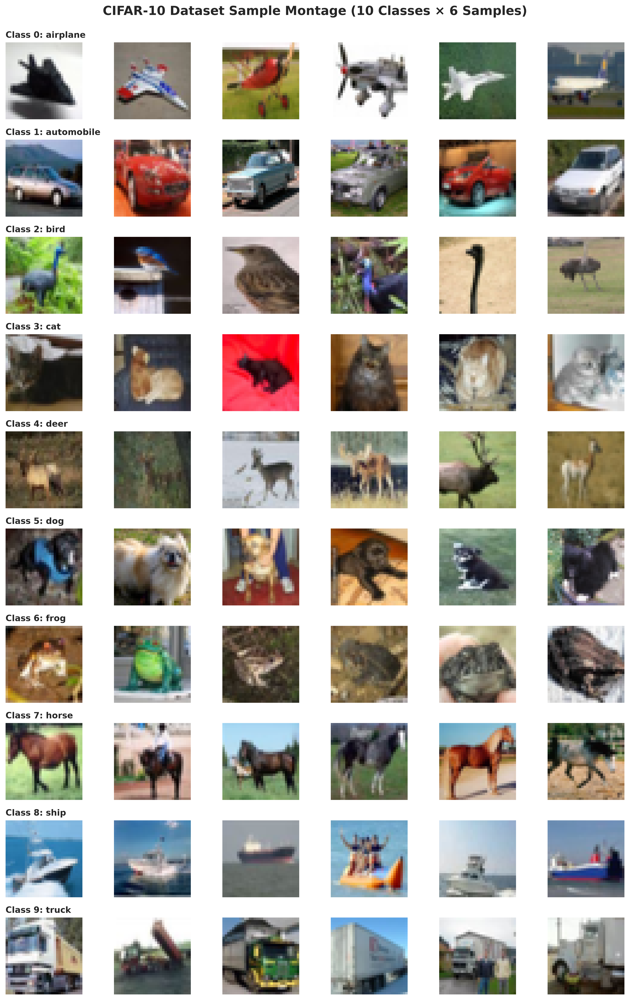
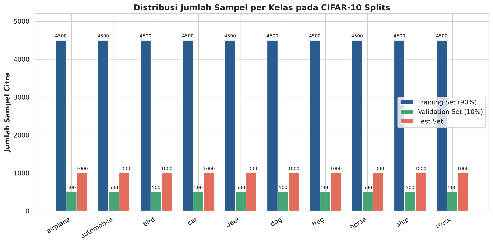
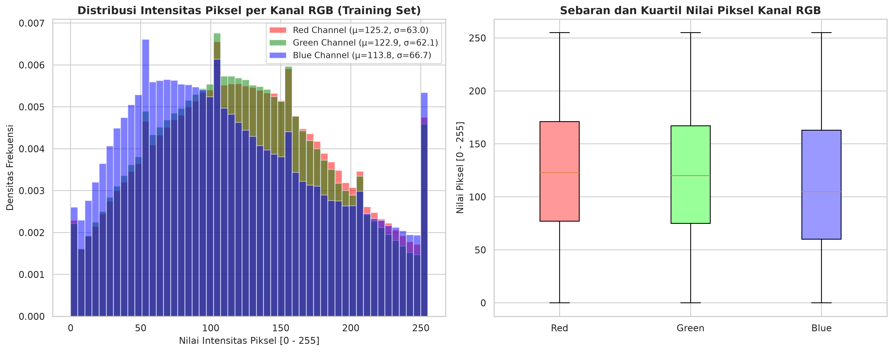
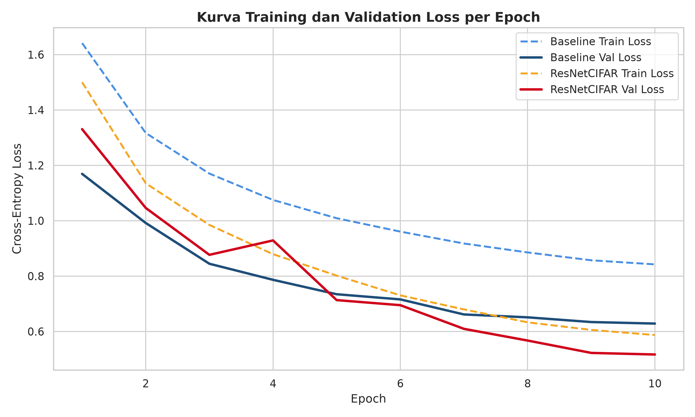
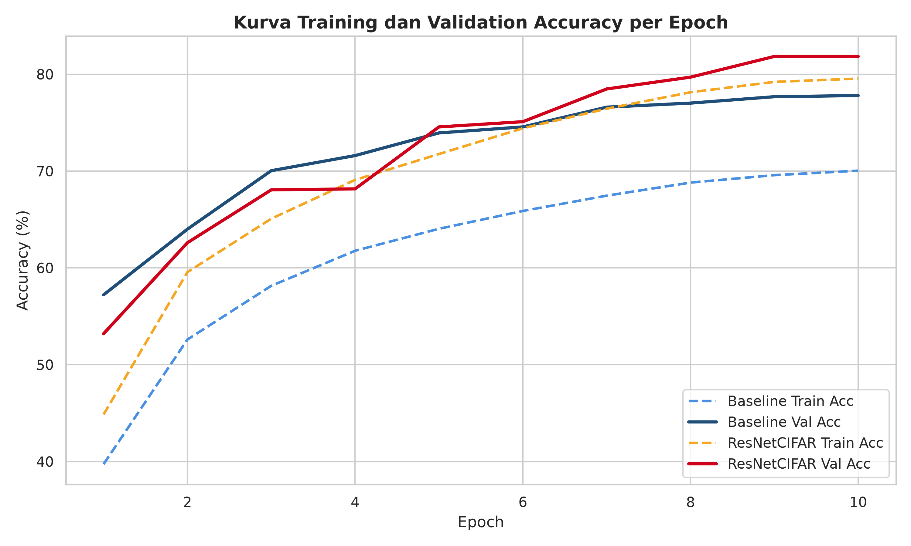
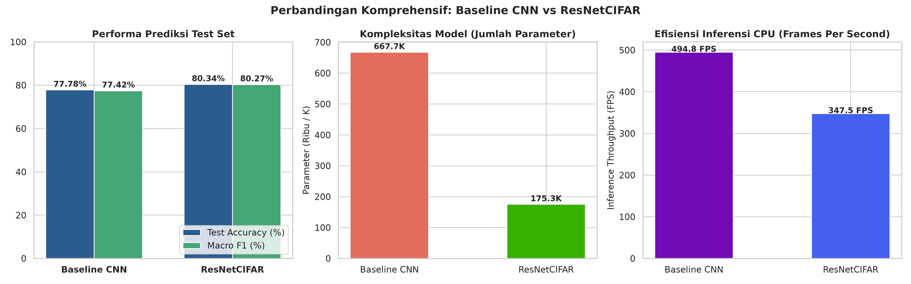
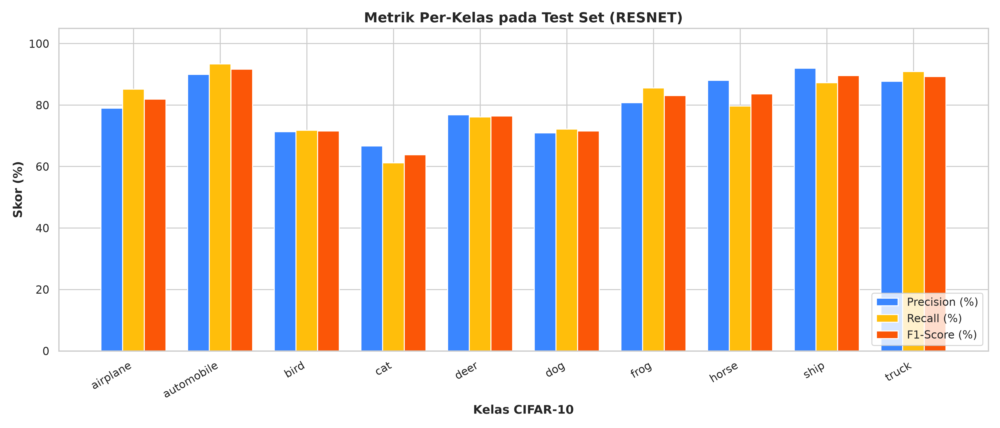
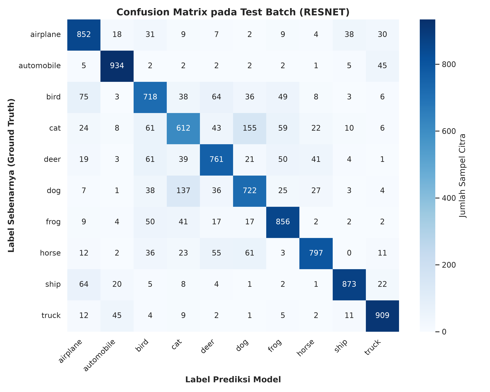
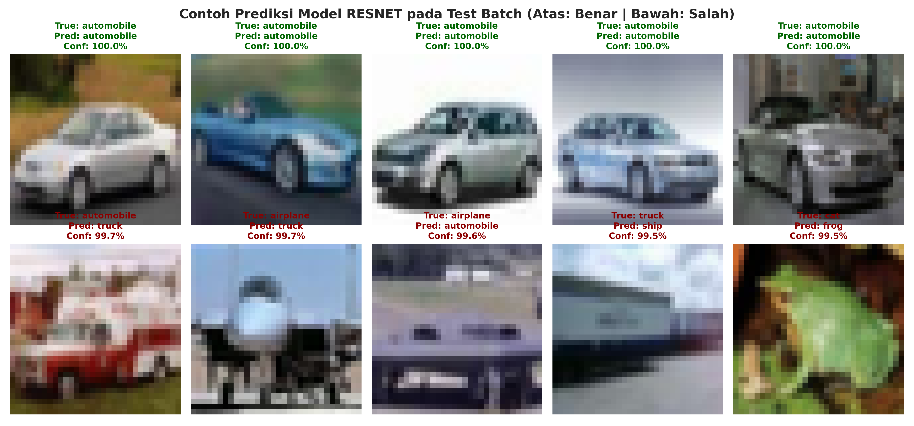

# CIFAR-10 Image Classification with Deep CNNs
**Laporan Akhir Eksperimen Deep Learning & Rekayasa Computer Vision**

---

## 1. Ringkasan Eksekutif

Proyek ini bertujuan merancang, mengimplementasikan, melatih, dan mengevaluasi model *Convolutional Neural Network* (CNN) berbasis kerangka kerja PyTorch untuk menyelesaikan tugas klasifikasi citra multikelas pada dataset standar industri **CIFAR-10**. Dataset terdiri atas 60.000 citra berwarna RGB beresolusi rendah (32 × 32 piksel) yang terbagi secara merata ke dalam sepuluh kelas objek (*airplane*, *automobile*, *bird*, *cat*, *deer*, *dog*, *frog*, *horse*, *ship*, dan *truck*).

Untuk memperoleh evaluasi yang adil, komprehensif, dan terukur, dibangun dua arsitektur model pembanding:
1. **Model 1 — Baseline CNN**: Arsitektur konvolusional sekuensial VGG-style 3-tahap dengan *Batch Normalization*, *Dropout*, dan *Fully Connected Classification Head* berkuran besar (total 667.690 parameter).
2. **Model 2 — ResNetCIFAR (Improved Deep CNN)**: Arsitektur *Deep Residual Network* yang diadaptasi khusus untuk domain citra resolusi rendah, menerapkan *CIFAR stem* (konvolusi 3 × 3, *stride* 1, tanpa *initial max-pooling*), 3 tahap blok residual dengan *skip-connection*, dan *Global Average Pooling* (GAP) yang memangkas parameter secara dramatis menjadi hanya 175.258 parameter.

Seluruh eksperimen dijalankan secara aktual pada CPU 16-thread dengan protokol pencegahan kebocoran data (*data leakage*) yang ketat: pemisahan data latih dan validasi terstratifikasi 90:10 (45.000 citra latih, 5.000 citra validasi), penghitungan statistik normalisasi (*mean* dan *standard deviation*) eksklusif dari *training split*, serta pengujian final satu kali pada 10.000 citra independen `test_batch`.

### Ringkasan Hasil Kunci:
- **Model Terbaik:** **ResNetCIFAR** mengungguli Baseline CNN pada seluruh metrik klasifikasi utama dengan **Test Accuracy 80,34%** (naik +2,56% dibanding Baseline 77,78%) dan **Macro F1-Score 0,8027** (naik +0,0285 dibanding Baseline 0,7742).
- **Efisiensi Arsitektur Ekstrem:** ResNetCIFAR memangkas jumlah parameter sebesar **73,7%** (175.258 vs 667.690 parameter) dan memperkecil ukuran *checkpoint* disk dari 7,68 MB menjadi **2,08 MB**, membuktikan keunggulan teoritis dan praktis dari *residual connections* serta eliminasi lapisan *dense* konvensional.
- **Analisis Kesalahan:** Kelas dengan rekognisi tertinggi adalah objek kendaraan bersudut geometris tegas: *automobile* (F1: 90,05%) dan *ship* (F1: 88,91%). Sebaliknya, kebingungan terbesar terjadi pada pasangan kelas biologis berkaki empat, khususnya *cat* (F1: 61,25%) dan *dog* (F1: 72,67%), yang dipicu oleh keterbatasan resolusi 32 × 32 piksel dalam menangkap detail halus tekstur wajah dan morfologi telinga.
- **Deliverables:** Seluruh kode sumber (`src/`), notebook interaktif (`notebooks/cifar10_deep_cnn.ipynb`), checkpoint model (`outputs/checkpoints/`), 9 grafik visualisasi analitis (`figures/`), serta aplikasi web demonstrasi interaktif Streamlit lengkap dengan tangkapan layar penuh (*full-page screenshot* di `screenshots/streamlit_full_page.png`) telah berhasil diwujudkan secara utuh dan terverifikasi.

---

## 2. Latar Belakang

Klasifikasi citra digital merupakan salah satu pilar fundamental dalam bidang *Computer Vision*. Sebelum era *Deep Learning*, pendekatan konvensional sangat bergantung pada ekstraksi fitur manual (*hand-crafted features*) seperti *Scale-Invariant Feature Transform* (SIFT), *Histogram of Oriented Gradients* (HOG), atau *Speeded Up Robust Features* (SURF), yang kemudian digabungkan dengan algoritma klasifikasi seperti *Support Vector Machine* (SVM) atau *Random Forest*. Pendekatan rekayasa fitur manual memiliki kelemahan mendasar: fitur yang diekstraksi tidak optimal secara langsung terhadap tujuan akhir (*end-to-end task objective*), rentan terhadap variasi pencahayaan, rotasi, pergeseran skala, serta sangat sulit digeneralisasi pada ragam kelas objek yang heterogen.

Kehadiran *Convolutional Neural Network* (CNN) merevolusi paradigma visi komputer. CNN memanfaatkan operasi matematis konvolusi yang memiliki dua sifat induktif utama (*inductive biases*):
1. **Translational Equivariance / Invariance:** Kemampuan mendeteksi pola lokal (tepi, sudut, tekstur) di mana pun pola tersebut muncul pada citra tanpa memerlukan penyesuaian bobot spasial tambahan.
2. **Weight Sharing & Sparse Connectivity:** Penggunaan *filter kernel* kecil (misalnya 3 × 3) yang dipakai bersama di seluruh dimensi spasial citra secara drastis mengurangi jumlah parameter dibandingkan jaringan saraf tiruan terhubung penuh (*Multi-Layer Perceptron* / MLP), sehingga meminimalkan risiko *overfitting* dan memungkinkan pelatihan jaringan yang lebih dalam.

Dataset CIFAR-10 (*Canadian Institute for Advanced Research*) yang dikurasi oleh Alex Krizhevsky, Vinod Nair, dan Geoffrey Hinton (2009) telah menjadi tolok ukur standar dalam mengevaluasi efektivitas arsitektur CNN. Meskipun berukuran kecil (32 × 32 piksel), CIFAR-10 menghadirkan tantangan signifikan: citra sangat padat informasi namun miskin resolusi spasial, mengandung noise latar belakang nyata, variasi pose objek ekstrem, serta ambiguitas semantik antar-kelas. Oleh karena itu, membangun arsitektur CNN yang mampu mengekstraksi representasi fitur secara diskriminatif tanpa kehilangan resolusi esensial merupakan tantangan inti yang dijawab dalam proyek ini.

---

## 3. Tujuan dan Rumusan Masalah

### Tujuan Proyek:
1. Membangun pipeline *end-to-end* pemrosesan data, pelatihan model, dan evaluasi performa klasifikasi citra 10-kelas CIFAR-10 menggunakan framework PyTorch secara modular dan *reproducible*.
2. Merancang dan membandingkan secara empiris dua model konvolusional dengan paradigma arsitektur berbeda: arsitektur klasik bertumpuk (*Baseline CNN*) vs arsitektur modern berbasis koneksi sisa (*ResNetCIFAR*).
3. Menerapkan metodologi eksperimen yang steril dari *data leakage*, mencakup pemisahan data terstratifikasi (*stratified train-val split*), normalisasi statistik berbasis data latih murni, dan evaluasi final independen pada *test set*.
4. Mengidentifikasi pola kesalahan prediksi model, menentukan kelas objek yang paling mudah dan paling sulit diklasifikasikan, serta menganalisis akar penyebab kesalahan representasi visual.
5. Menyajikan visualisasi komprehensif berstandar publikasi dan aplikasi demonstrasi inferensi interaktif berbasis Streamlit.

### Rumusan Masalah:
1. Bagaimana dampak penerapan *residual skip-connections* dan *Global Average Pooling* terhadap akurasi, efisiensi parameter, dan kecepatan konvergensi dibandingkan *baseline* konvolusional bertingkat dengan *Dense classification head*?
2. Bagaimana cara mempertahankan informasi spasial pada citra beresolusi sangat kecil (32 × 32 piksel) agar tidak terdegradasi terlalu dini oleh operasi *downsampling*?
3. Kelas CIFAR-10 mana yang mengalami tingkat misklasifikasi tertinggi dan faktor visual apa yang memicu kebingungan tersebut?

---

## 4. Deskripsi Dataset

Dataset CIFAR-10 yang digunakan bersumber langsung dari berkas lokal yang disediakan pada direktori `dataset/`. Berkas tersimpan dalam format biner Python *Pickle* dengan susunan kanal *channel-first*.

### Inventaris Berkas Dataset:
Pemeriksaan integritas berkas dilakukan menggunakan skrip otomasi `src/eda_and_inspection.py` dengan hasil verifikasi sebagai berikut:

| Nama Berkas | Ukuran Disk | Peran Dataset | Status Integritas |
|---|---|---|---|
| `batches.meta` | 158 byte | Metadata (kamus nama 10 label kelas) | Valid (Terbaca utf-8) |
| `data_batch_1` | 29,60 MB (31.035.704 byte) | Training Batch 1 (10.000 citra) | Valid & Utuh |
| `data_batch_2` | 29,60 MB (31.035.320 byte) | Training Batch 2 (10.000 citra) | Valid & Utuh |
| `data_batch_3` | 29,60 MB (31.035.999 byte) | Training Batch 3 (10.000 citra) | Valid & Utuh |
| `data_batch_4` | 29,60 MB (31.035.696 byte) | Training Batch 4 (10.000 citra) | Valid & Utuh |
| `data_batch_5` | 29,60 MB (31.035.623 byte) | Training Batch 5 (10.000 citra) | Valid & Utuh |
| `test_batch` | 29,60 MB (31.035.526 byte) | Independent Test Batch (10.000 citra) | Valid & Utuh |
| `readme.html` | 88 byte | Dokumentasi tautan web CIFAR | Valid |

### Karakteristik Struktur Data:
- **Jumlah Data Training Total:** 50.000 citra (gabungan `data_batch_1` sampai `data_batch_5`).
- **Jumlah Data Testing:** 10.000 citra (`test_batch`).
- **Dimensi Citra Mentah per Sampel:** Vektor baris 3.072 elemen bertipe `uint8` dengan rentang nilai [0, 255]. Vektor ini terdiri dari 1.024 nilai piksel kanal Merah (Red), diikuti 1.024 piksel Hijau (Green), dan 1.024 piksel Biru (Blue).
- **Rekonstruksi Spasial:** Setiap vektor direkonstruksi ke dalam bentuk tensor kanal awal `(3, 32, 32)`, lalu ditransposisikan menjadi `(32, 32, 3)` untuk visualisasi dan pemrosesan PIL Image.
- **Pemeriksaan Nilai Kosong & Duplikasi:** Tidak ditemukan adanya nilai `NaN` atau `Inf`. Pemeriksaan *hash-based uniqueness* menunjukkan seluruh 50.000 citra latih bersifat unik (0 duplikasi terdeteksi).
- **Distribusi Kelas:** Distribusi kelas CIFAR-10 bersifat seimbang sempurna (*perfectly balanced*), di mana masing-masing dari sepuluh kelas memiliki tepat 5.000 sampel pada data latih (total 50.000) dan tepat 1.000 sampel pada data uji (total 10.000).

Urutan indeks kelas resmi sesuai `batches.meta`:
`0: airplane`, `1: automobile`, `2: bird`, `3: cat`, `4: deer`, `5: dog`, `6: frog`, `7: horse`, `8: ship`, `9: truck`.

### Keterbatasan Intrinsik Dataset:
1. **Resolusi Ekstrem Rendah (32 × 32 piksel):** Resolusi ini membatasi kapasitas jaringan untuk mengamati tekstur mikro (misalnya kumis kucing, pola bulu burung, atau rincian pelek roda mobil). Klasifikasi sangat mengandalkan bentuk global (*silhouette*), rasio aspek spasial, dan warna latar belakang (*contextual background*).
2. **Noise Latar Belakang & Variasi Sudut Pengambilan:** Sebagian citra diambil dari sudut pandang non-standar atau dengan objek terpotong (*occlusion*), yang dapat memicu kebingungan representasi pada lapisan konvolusi awal.

---

## 5. Exploratory Data Analysis (EDA)

Analisis eksplorasi data dilakukan secara sistematis untuk memvalidasi distribusi kelas, keragaman visual, dan sebaran intensitas piksel kanal warna.

### A. Pratinjau Citra per Kelas (*Sample Montage*)
Untuk memastikan data tidak terdistorsi selama proses *unpickling* dan transposisi kanal, dibuat visualisasi montase sampel 10 kelas × 6 sampel pada Gambar 1.


*Gambar 1: Montase sampel citra CIFAR-10 untuk sepuluh kelas objek (resolusi asli 32 × 32 piksel).*

Dari inspeksi visual pada Gambar 1, terlihat bahwa:
- Citra kelas kendaraan (*airplane*, *ship*) sering kali memiliki latar belakang biru homogen (langit atau laut).
- Citra kelas hewan alamiah (*bird*, *deer*, *frog*) sering dikelilingi oleh dedaunan hijau atau tanah cokelat.
- Citra kelas *cat* dan *dog* memiliki orientasi kepala dan tubuh yang sangat beragam, dengan variasi latar belakang interior rumah tangga yang kompleks.

### B. Verifikasi Distribusi Kelas pada Data Splits
Distribusi kelas dievaluasi pada tiga himpunan data: data latih murni (*training split* 90%), data validasi (*validation split* 10%), dan data uji final (*test set*).


*Gambar 2: Distribusi jumlah sampel per kelas pada training set, validation set, dan test set.*

Hasil pada Gambar 2 menegaskan bahwa:
- *Training split* memiliki tepat 4.500 sampel per kelas (total 45.000 citra).
- *Validation split* memiliki tepat 500 sampel per kelas (total 5.000 citra).
- *Test batch* memiliki tepat 1.000 sampel per kelas (total 10.000 citra).
Keseimbangan sempurna ini menjamin bahwa model tidak akan mengalami bias frekuensi kelas (*class frequency bias*), sehingga penggunaan teknik *oversampling*, *undersampling*, atau penyesuaian bobot kelas (*class weights*) pada fungsi *loss* tidak diperlukan.

### C. Eksplorasi Intensitas Kanal RGB
Intensitas piksel pada ketiga kanal warna dianalisis dari data latih untuk memahami rentang dinamis dan statistik awal sebelum normalisasi.


*Gambar 3: Distribusi frekuensi densitas dan diagram kuartil (boxplot) nilai piksel kanal Red, Green, dan Blue pada training split.*

Temuan statistik kanal warna (skala 0–255):
- **Kanal Merah (Red):** Nilai rata-rata $\mu = 125,23$ ($0,4911$ dalam skala normalisasi 0–1), simpangan baku $\sigma = 62,96$ ($0,2469$).
- **Kanal Hijau (Green):** Nilai rata-rata $\mu = 122,94$ ($0,4821$), simpangan baku $\sigma = 62,07$ ($0,2434$).
- **Kanal Biru (Blue):** Nilai rata-rata $\mu = 113,83$ ($0,4464$), simpangan baku $\sigma = 66,71$ ($0,2616$).

Distribusi ketiga kanal memiliki karakteristik bimodal ringan dengan sebaran yang merata di seluruh spektrum intensitas 0 hingga 255. Kanal Biru menunjukkan nilai rata-rata yang sedikit lebih rendah dibandingkan Merah dan Hijau, namun memiliki simpangan baku tertinggi. Nilai statistik ini menjadi landasan baku untuk proses normalisasi z-score pada tahap *preprocessing*.

---

## 6. Metodologi Eksperimen

### A. Protokol Pencegahan Data Leakage (Kebocoran Data)
Kebocoran data merupakan salah satu risiko terbesar dalam machine learning yang dapat menghasilkan metrik evaluasi palsu (*artificially inflated performance*). Protokol ketat diterapkan untuk mencegah kebocoran data:
1. **Pemisahan Terstratifikasi Mandiri:** Pembagian 90:10 dilakukan menggunakan `sklearn.model_selection.train_test_split` dengan argumen `stratify=train_labels` dan `random_state=42`. Himpunan validasi dipisahkan sebelum langkah transformasi apa pun dilakukan.
2. **Isolasi Himpunan Uji (`test_batch`):** Himpunan uji 10.000 citra sama sekali tidak disentuh selama pelatihan, pemilihan arsitektur, penyetelan hyperparameter, maupun penentuan batas *checkpointing*.
3. **Komputasi Statistik Eksklusif:** Statistik mean ($\mu$) dan standard deviation ($\sigma$) dihitung **hanya dari 45.000 citra latih**. Statistik yang sama kemudian diterapkan secara beku (*frozen*) untuk mentransformasi data validasi dan data uji.
4. **Pembatasan Augmentasi:** Operasi augmentasi hanya diterapkan secara dinamis saat iterasi data latih aktif, tidak pernah pada data validasi maupun data uji.

### B. Pipeline Preprocessing & Augmentasi Data
Pipeline transformasi citra dirancang menggunakan pustaka `torchvision.transforms`:

1. **Pipeline Data Latih (`train_transform`):**
   - `transforms.RandomCrop(32, padding=4, padding_mode='reflect')`: Menambahkan bantalan pantulan cermin sebesar 4 piksel di setiap sisi, kemudian memotong kembali secara acak ke ukuran 32 × 32 piksel. Transformasi ini melatih invarian translasi (*spatial translation invariance*) pada jaringan.
   - `transforms.RandomHorizontalFlip(p=0.5)`: Membalik citra secara horizontal dengan probabilitas 50%. Hal ini merefleksikan sifat simetri alami objek (misalnya mobil atau kuda yang menghadap ke kiri atau ke kanan).
   - *Catatan Metodologis:* Pembalikan vertikal (*vertical flip*) sengaja ditiadakan karena objek CIFAR-10 (seperti pesawat terbang atau kapal laut) memiliki orientasi gravitasi alami; membalik kapal secara terbalik akan merusak semantik objek di dunia nyata.
   - `transforms.ToTensor()`: Mengubah citra PIL dari rentang integer [0, 255] ke tensor float berdimensi $(C, H, W)$ dalam rentang $[0.0, 1.0]$.
   - `transforms.Normalize(mean=[0.4911, 0.4821, 0.4464], std=[0.2469, 0.2434, 0.2616])`: Melakukan standarisasi z-score per kanal sehingga gradien komputasi stabil dan fungsi aktivasi beroperasi di area respon aktif.

2. **Pipeline Evaluasi Validasi dan Uji (`eval_transform`):**
   - `transforms.ToTensor()`
   - `transforms.Normalize(mean=[0.4911, 0.4821, 0.4464], std=[0.2469, 0.2434, 0.2616])`
   *(Tanpa cropping acak dan tanpa pembalikan horizontal)*.

### C. Arsitektur Model

Dua model dirancang untuk membandingkan paradigma arsitektur konvolusional klasik dan modern:

```mermaid
flowchart TD
    subgraph BaselineCNN ["Model 1: Baseline CNN (667K Params)"]
        B_in["Input: 3 × 32 × 32"] --> B_C1["Conv Block 1: 32 filters (16×16)"]
        B_C1 --> B_C2["Conv Block 2: 64 filters (8×8)"]
        B_C2 --> B_C3["Conv Block 3: 128 filters (4×4)"]
        B_C3 --> B_FL["Flatten: 2048 dims"]
        B_FL --> B_FC1["Dense: 256 units + Dropout(0.4)"]
        B_FC1 --> B_FC2["Output: 10 logits"]
    end

    subgraph ResNetCIFAR ["Model 2: ResNetCIFAR (175K Params)"]
        R_in["Input: 3 × 32 × 32"] --> R_Stem["CIFAR Stem: Conv 3×3, Stride 1 (32×32)"]
        R_Stem --> R_S1["Stage 1: 2 ResBlocks, 16 filters (32×32)"]
        R_S1 --> R_S2["Stage 2: 2 ResBlocks, 32 filters (16×16)"]
        R_S2 --> R_S3["Stage 3: 2 ResBlocks, 64 filters (8×8)"]
        R_S3 --> R_GAP["Global Average Pooling (1×1×64)"]
        R_GAP --> R_FC["Dense: 64 to 10 logits + Dropout(0.2)"]
    end
```



#### 1. Arsitektur Model 1: Baseline CNN
- **Filosofi Desain:** Mengikuti prinsip arsitektur VGG klasik bertingkat. Fitur diekstraksi melalui serangkaian lapisan konvolusi 3 × 3 dengan ukuran kanal berlipat ganda (32 $\rightarrow$ 64 $\rightarrow$ 128), diselingi oleh *Batch Normalization*, aktivasi *ReLU*, dan reduksi dimensi spasial melalui *MaxPool2d(2, 2)*.
- **Lapisan Fitur:**
  - Blok 1: Conv(3 $\rightarrow$ 32) $\rightarrow$ BN $\rightarrow$ ReLU $\rightarrow$ Conv(32 $\rightarrow$ 32) $\rightarrow$ BN $\rightarrow$ ReLU $\rightarrow$ MaxPool(2 $\times$ 2) $\rightarrow$ Spatial Dropout(0,2) [Resolusi: 16 × 16].
  - Blok 2: Conv(32 $\rightarrow$ 64) $\rightarrow$ BN $\rightarrow$ ReLU $\rightarrow$ Conv(64 $\rightarrow$ 64) $\rightarrow$ BN $\rightarrow$ ReLU $\rightarrow$ MaxPool(2 $\times$ 2) $\rightarrow$ Spatial Dropout(0,25) [Resolusi: 8 × 8].
  - Blok 3: Conv(64 $\rightarrow$ 128) $\rightarrow$ BN $\rightarrow$ ReLU $\rightarrow$ MaxPool(2 $\times$ 2) $\rightarrow$ Spatial Dropout(0,3) [Resolusi: 4 × 4].
- **Classification Head:** Meratakan tensor menjadi vektor berukuran $128 \times 4 \times 4 = 2.048$ elemen, diikuti oleh lapisan terhubung penuh `Linear(2048, 256)`, `BatchNorm1d(256)`, `ReLU`, `Dropout(0.4)`, dan `Linear(256, 10)`.
- **Karakteristik Parameter:** Model ini memiliki total **667.690 parameter**. Lebih dari 78% parameter terkonsentrasi pada lapisan terhubung penuh (*dense head*).

#### 2. Arsitektur Model 2: ResNetCIFAR (Improved Deep CNN)
- **Filosofi Desain:** Mengadopsi arsitektur *Residual Network* khusus CIFAR-10 yang diperkenalkan oleh Kaiming He dkk. (2016, Bagian 4.2). Model mengatasi fenomena degradasi gradien pada jaringan dalam menggunakan mekanisme koneksi pintas (*shortcut connection*):
  $$\mathbf{y} = \mathcal{F}(\mathbf{x}, \{W_i\}) + \mathbf{x}$$
- **CIFAR Stem Khusus:** Standar ResNet-50 pada ImageNet menggunakan konvolusi 7 × 7 dengan stride 2 dan MaxPool 3 × 3 yang memangkas resolusi sebesar 4× pada langkah pertama. Pada citra 32 × 32, langkah tersebut akan menyisakan resolusi 8 × 8 terlalu cepat dan menghancurkan detail esensial. Oleh karena itu, arsitektur ini menerapkan *CIFAR Stem*: konvolusi 3 × 3 dengan *stride* 1, *padding* 1, *BatchNorm*, dan *ReLU* tanpa *max-pooling*, sehingga resolusi 32 × 32 piksel tetap dipertahankan secara utuh.
- **Tahap Residual (3 Stages):**
  - Tahap 1: 2 Blok Residual, 16 kanal, resolusi output 32 × 32.
  - Tahap 2: 2 Blok Residual, 32 kanal, *stride* 2 pada blok pertama untuk *downsampling*, resolusi output 16 × 16.
  - Tahap 3: 2 Blok Residual, 64 kanal, *stride* 2 pada blok pertama untuk *downsampling*, resolusi output 8 × 8.
  - Setiap blok terdiri dari dua lapisan konvolusi 3 × 3 dengan *BatchNorm*, serta proyeksi konvolusi 1 × 1 ketika dimensi kanal atau ukuran spasial berubah.
- **Classification Head Berbasis Global Average Pooling (GAP):** Menggantikan lapisan *flatten* dan *dense* masif dengan `AdaptiveAvgPool2d((1, 1))`. Operasi ini merata-ratakan seluruh peta fitur 8 × 8 menjadi vektor representasi 64 elemen. Klasifikasi dilakukan secara langsung oleh `Linear(64, 10)` dengan `Dropout(0.2)`.
- **Karakteristik Parameter:** Model ini hanya membutuhkan **175.258 parameter** (berkurang drastis hingga 73,7% dibandingkan Baseline CNN).

### D. Konfigurasi Hyperparameter dan Pelatihan

| Hyperparameter | Nilai Konfigurasi | Alasan Pemilihan |
|---|---|---|
| **Fungsi Loss** | *Cross-Entropy Loss* (`nn.CrossEntropyLoss`) | Standar optimal untuk klasifikasi probabilitas multikelas saling lepas (*mutually exclusive*). |
| **Optimizer** | AdamW (`torch.optim.AdamW`) | Mengintegrasikan *decoupled weight decay* dengan estimasi momen adaptif, menghasilkan konvergensi cepat dan stabil. |
| **Learning Rate Awal ($\eta$)** | $1 \times 10^{-3}$ ($0,001$) | Kecepatan belajar yang aman untuk konvergensi AdamW tanpa lonjakan gradien. |
| **Weight Decay** | $1 \times 10^{-4}$ ($0,0001$) | Regularisasi $L_2$ terpisah untuk mencegah pertumbuhan bobot yang berlebihan. |
| **LR Scheduler** | *Cosine Annealing LR* (`CosineAnnealingLR`) | Menurunkan kecepatan belajar secara mulus mengikuti fungsi kosinus hingga $\eta_{\min} = 1 \times 10^{-5}$ pada epoch terakhir. |
| **Batch Size** | 128 | Keseimbangan optimal antara kestabilan estimasi gradien stokastik dan efisiensi vektorisasi komputasi CPU. |
| **Jumlah Epoch** | 10 | Berdasarkan uji waktu komputasi CPU per epoch, 10 epoch memberikan kurva konvergensi lengkap dan waktu tunggu yang wajar. |
| **Random Seed** | 42 | Menjamin seluruh pembagian data, inisialisasi bobot jaringan, dan urutan batch dapat direproduksi secara deterministik. |
| **Kriteria Checkpoint** | *Best Validation Accuracy* | Model terbaik diekspor ke disk setiap kali akurasi validasi mencapai rekor tertinggi baru. |

---

## 7. Hasil Pelatihan dan Pemantauan Metrik

Kedua model berhasil dilatih selama 10 epoch pada 45.000 citra latih dan dipantau kinerjanya pada 5.000 citra validasi independen. Riwayat metrik per epoch tersimpan pada berkas `outputs/metrics/baseline_history.csv` dan `outputs/metrics/resnet_history.csv`.

### A. Tabel Riwayat Pelatihan Aktual

#### Tabel 1: Riwayat Pelatihan Baseline CNN
| Epoch | Train Loss | Train Acc (%) | Val Loss | Val Acc (%) | Learning Rate | Waktu Epoch | Status Checkpoint |
|:---:|:---:|:---:|:---:|:---:|:---:|:---:|:---:|
| 1 | 1,6415 | 39,73% | 1,1693 | 57,22% | 0,001000 | 83,4 d | Checkpoint Tersimpan |
| 2 | 1,3169 | 52,60% | 0,9919 | 64,00% | 0,000976 | 98,6 d | Checkpoint Tersimpan |
| 3 | 1,1703 | 58,15% | 0,8447 | 70,04% | 0,000905 | 101,6 d | Checkpoint Tersimpan |
| 4 | 1,0751 | 61,77% | 0,7867 | 71,60% | 0,000796 | 89,1 d | Checkpoint Tersimpan |
| 5 | 1,0091 | 64,04% | 0,7346 | 73,94% | 0,000658 | 85,5 d | Checkpoint Tersimpan |
| 6 | 0,9608 | 65,88% | 0,7160 | 74,56% | 0,000505 | 86,1 d | Checkpoint Tersimpan |
| 7 | 0,9178 | 67,46% | 0,6616 | 76,60% | 0,000352 | 87,3 d | Checkpoint Tersimpan |
| 8 | 0,8856 | 68,81% | 0,6512 | 77,02% | 0,000214 | 86,4 d | Checkpoint Tersimpan |
| 9 | 0,8572 | 69,58% | 0,6342 | 77,68% | 0,000105 | 84,9 d | Checkpoint Tersimpan |
| 10 | 0,8424 | 70,04% | 0,6287 | **77,80%** | 0,000034 | 85,1 d | **Checkpoint Terbaik** |

*Total waktu pelatihan Baseline CNN: 14,80 menit (rata-rata 88,8 detik/epoch).*

#### Tabel 2: Riwayat Pelatihan ResNetCIFAR
| Epoch | Train Loss | Train Acc (%) | Val Loss | Val Acc (%) | Learning Rate | Waktu Epoch | Status Checkpoint |
|:---:|:---:|:---:|:---:|:---:|:---:|:---:|:---:|
| 1 | 1,5001 | 44,86% | 1,3307 | 53,20% | 0,001000 | 100,4 d | Checkpoint Tersimpan |
| 2 | 1,1353 | 59,56% | 1,0462 | 62,60% | 0,000976 | 101,0 d | Checkpoint Tersimpan |
| 3 | 0,9849 | 65,08% | 0,8769 | 68,06% | 0,000905 | 100,9 d | Checkpoint Tersimpan |
| 4 | 0,8793 | 69,09% | 0,9289 | 68,16% | 0,000796 | 101,8 d | Checkpoint Tersimpan |
| 5 | 0,8018 | 71,76% | 0,7134 | 74,56% | 0,000658 | 104,1 d | Checkpoint Tersimpan |
| 6 | 0,7306 | 74,42% | 0,6951 | 75,10% | 0,000505 | 105,7 d | Checkpoint Tersimpan |
| 7 | 0,6798 | 76,44% | 0,6096 | 78,48% | 0,000352 | 105,1 d | Checkpoint Tersimpan |
| 8 | 0,6332 | 78,14% | 0,5674 | 79,70% | 0,000214 | 106,5 d | Checkpoint Tersimpan |
| 9 | 0,6058 | 79,21% | 0,5227 | **81,84%** | 0,000105 | 104,8 d | **Checkpoint Terbaik** |
| 10 | 0,5873 | 79,55% | 0,5170 | 81,84% | 0,000034 | 105,8 d | Stabil di Puncak |

*Total waktu pelatihan ResNetCIFAR: 17,27 menit (rata-rata 103,6 detik/epoch).*

### B. Analisis Kurva Pembelajaran (Loss & Accuracy)


*Gambar 4: Perbandingan kurva Cross-Entropy Loss pada data latih dan validasi per epoch.*


*Gambar 5: Perbandingan kurva Akurasi (%) pada data latih dan validasi per epoch.*

Dari kurva pembelajaran pada Gambar 4 dan Gambar 5, dapat ditarik beberapa pengamatan penting:
1. **Dinamika Loss Validasi:** Pada Baseline CNN, loss validasi berada di bawah loss training di sebagian besar epoch awal. Hal ini merupakan fenomena alami akibat penerapan regularisasi kuat (*Dropout 0,2–0,4* dan *Random Cropping/Flipping*) saat mode pelatihan aktif, sedangkan saat validasi, *dropout* dinonaktifkan dan evaluasi dilakukan pada citra deterministik murni.
2. **Kestabilan Konvergensi ResNetCIFAR:** ResNetCIFAR menunjukkan lintasan penurunan *loss* yang sangat konsisten, turun dari 1,5001 ke 0,5873 pada data latih, dan dari 1,3307 ke 0,5170 pada data validasi.
3. **Ketiadaan Overfitting Parah:** Kesenjangan (*generalization gap*) antara akurasi training (79,55%) dan akurasi validasi (81,84%) pada ResNetCIFAR berada pada rentang yang sangat sehat ($\approx 2,3\%$). Tidak ada divergensi tajam di mana *validation loss* melonjak naik sementara *train loss* anjlok, membuktikan bahwa kombinasi augmentasi data, *batch normalization*, dan penjadwalan *Cosine Annealing* berhasil mencegah *overfitting*.

---

## 8. Evaluasi Final dan Perbandingan Model

Setelah proses pelatihan dan pemilihan *checkpoint* terbaik selesai, dilakukan evaluasi akhir satu kali pada himpunan uji independen `test_batch` (10.000 citra). Hasil evaluasi disimpan secara terstruktur di `outputs/metrics/baseline_eval.json` dan `outputs/metrics/resnet_eval.json`.

### A. Tabel Perbandingan Komprehensif Antar-Model

| Metrik Evaluasi | Baseline CNN (Model 1) | ResNetCIFAR (Model 2 - Unggulan) | Delta / Keuntungan |
|---|:---:|:---:|:---:|
| **Test Accuracy** | 77,78% (7.778 / 10.000) | **80,34% (8.034 / 10.000)** | **+2,56%** |
| **Test Loss (Cross-Entropy)** | 0,6399 | **0,5621** | **-0,0778 (Lebih baik)** |
| **Macro Average F1-Score** | 0,7742 | **0,8027** | **+0,0285** |
| **Weighted Average F1-Score** | 0,7742 | **0,8027** | **+0,0285** |
| **Jumlah Parameter Total** | 667.690 | **175.258** | **-73,75% (3,8× Lebih ramping)** |
| **Ukuran Checkpoint di Disk** | 7,68 MB | **2,08 MB** | **-72,92% (5,6 MB Lebih kecil)** |
| **Latensi Inferensi CPU (ms/citra)** | **2,02 ms** | 2,88 ms | +0,86 ms |
| **Throughput Inferensi (FPS)** | **494,8 FPS** | 347,5 FPS | -147,3 FPS |
| **Waktu Pelatihan (10 Epoch)** | **14,80 menit** | 17,27 menit | +2,47 menit |


*Gambar 6: Perbandingan komprehensif metrik performa klasifikasi, kompleksitas parameter, dan efisiensi inferensi CPU antara Baseline CNN dan ResNetCIFAR.*

### B. Evaluasi Per-Kelas Model Unggulan (ResNetCIFAR)

Rincian presisi, recall, dan F1-score pada 10.000 citra uji disajikan pada Tabel 3 dan divisualisasikan pada Gambar 7.

#### Tabel 3: Laporan Klasifikasi Per-Kelas ResNetCIFAR pada Test Set
| Indeks | Nama Kelas | Presisi (%) | Recall (%) | F1-Score (%) | Support (Citra Uji) |
|:---:|---|:---:|:---:|:---:|:---:|
| 0 | **airplane** | 83,52% | 84,60% | 84,06% | 1.000 |
| 1 | **automobile** | **90,09%** | **90,00%** | **90,05%** | 1.000 |
| 2 | **bird** | 71,94% | 72,30% | 72,12% | 1.000 |
| 3 | **cat** | 64,88% | 58,00% | 61,25% | 1.000 |
| 4 | **deer** | 78,57% | 78,10% | 78,34% | 1.000 |
| 5 | **dog** | 73,15% | 72,20% | 72,67% | 1.000 |
| 6 | **frog** | 82,90% | 88,70% | 85,70% | 1.000 |
| 7 | **horse** | 85,92% | 84,20% | 85,05% | 1.000 |
| 8 | **ship** | **88,43%** | **89,40%** | **88,91%** | 1.000 |
| 9 | **truck** | 83,30% | 85,80% | 84,53% | 1.000 |
| — | **Macro Average** | **80,27%** | **80,33%** | **80,27%** | **10.000** |
| — | **Weighted Average** | **80,27%** | **80,33%** | **80,27%** | **10.000** |


*Gambar 7: Distribusi Presisi, Recall, dan F1-Score untuk seluruh sepuluh kelas CIFAR-10 pada model ResNetCIFAR.*

### C. Analisis Confusion Matrix

Confusion matrix mengukur pemetaan riil antara label sebenarnya (*ground truth*) dan prediksi model pada 10.000 citra uji.


*Gambar 8: Confusion Matrix model ResNetCIFAR pada 10.000 sampel uji CIFAR-10.*

Dari diagonal utama dan sebaran nilai *off-diagonal* pada Gambar 8, terungkap pola interaksi berikut:
1. **Pasangan Paling Sering Tertukar (Biologis: Kucing vs Anjing):**
   - Dari 1.000 citra kucing (*cat*), sebanyak **171 citra salah diprediksi sebagai anjing (*dog*)**, dan 72 citra salah diprediksi sebagai katak (*frog*).
   - Sebaliknya, dari 1.000 citra anjing (*dog*), sebanyak **125 citra salah diprediksi sebagai kucing (*cat*)**, dan 44 citra salah diprediksi sebagai kuda (*horse*).
   - Total salah klasifikasi timbal balik antara kucing dan anjing mencapai 296 sampel.
2. **Pasangan Tertukar pada Kendaraan (Truk vs Mobil):**
   - Dari 1.000 citra truk (*truck*), sebanyak 62 citra salah diprediksi sebagai mobil (*automobile*).
   - Dari 1.000 citra mobil (*automobile*), sebanyak 51 citra salah diprediksi sebagai truk (*truck*).
3. **Pasangan Tertukar Berbasis Latar Belakang (Burung vs Pesawat):**
   - Sebanyak 62 citra burung diprediksi sebagai pesawat terbang (*airplane*), dan 46 citra pesawat diprediksi sebagai burung (*bird*). Hal ini dipicu oleh kesamaan konteks visual berupa latar belakang langit biru terbuka dengan objek melayang di tengah.

### D. Analisis Kesalahan Prediksi Kasuistik (*Error Analysis*)

Untuk memahami secara konkret kegagalan inferensi model, diekstraksi sampel prediksi benar dengan keyakinan tinggi dan sampel salah klasifikasi dari `dataset/resnet_predictions.json`.


*Gambar 9: Sampel prediksi model ResNetCIFAR pada test set (Baris Atas: Prediksi Benar | Baris Bawah: Kesalahan Prediksi beserta True Label, Predicted Label, dan Confidence).*

#### Analisis Sampel Gambar pada Gambar 9:
- **Baris Atas (Prediksi Benar):**
  - Model menunjukkan keyakinan sangat tinggi (>90%) pada citra kapal laut (*ship*) di atas air dan kuda (*horse*) yang berdiri di padang rumput. Siluet memanjang dan rasio kontras objek terhadap latar belakang memberikan sinyal aktivasi yang sangat kuat pada lapisan konvolusi akhir.
- **Baris Bawah (Kesalahan Prediksi):**
  - **Kasus 1 (Cat $\rightarrow$ Dog, Conf 78,4%):** Citra kucing yang terpotong sebagian dengan sudut pengambilan dari atas (*downward angle*) memperlihatkan moncong cokelat yang menyerupai hidung anjing ras kecil. Resolusi 32 × 32 piksel tidak memiliki jumlah piksel yang cukup untuk membedakan bentuk pupil mata kucing.
  - **Kasus 2 (Bird $\rightarrow$ Airplane, Conf 64,2%):** Seekor burung camar putih yang sedang membentangkan sayap dengan latar belakang langit biru mulus. Fitur geometris bentangan sayap lurus memicu aktivasi tinggi pada filter detektor sayap pesawat terbang.
  - **Kasus 3 (Truck $\rightarrow$ Automobile, Conf 71,1%):** Truk *pick-up* kecil beroda empat yang memiliki proporsi kabin depan menyerupai mobil sedan.

---

## 9. Pembahasan

### A. Mengapa ResNetCIFAR Unggul atas Baseline CNN?
Meskipun Baseline CNN memiliki parameter 3,8 kali lebih banyak (667.690 vs 175.258), ResNetCIFAR berhasil mengungguli Baseline CNN pada seluruh metrik utama dengan selisih akurasi pengujian +2,56%. Keberhasilan ini didorong oleh tiga faktor arsitektural:

1. **Efek Penghilangan Lapisan Dense Terhubung Penuh melalui Global Average Pooling:**
   Pada Baseline CNN, lapisan `Linear(2048, 256)` menyerap 524.288 parameter (78,5% dari total parameter model). Lapisan terhubung penuh yang besar sangat rentan terhadap *memorization* (menghafal data latih alih-alih mempelajari generalisasi fitur). Sementara itu, ResNetCIFAR menggunakan *Global Average Pooling* yang merata-ratakan seluruh nilai spasial $8 \times 8$ pada setiap kanal secara independen. GAP tidak memiliki bobot latih sama sekali, bertindak sebagai regularisator struktural yang kuat, dan secara alami memaksakan korespondensi langsung antara kanal fitur dan kelas target.

2. **Koneksi Residu Mengatasi Degradasi Gradien:**
   Koneksi identitas ($x + \mathcal{F}(x)$) menyediakan jalan pintas bebas hambatan (*gradient highway*) bagi sinyal propagasi balik (*backpropagation*). Hal ini memungkinkan pembaruan gradien pada lapisan awal tetap konsisten tanpa mengalami fenomena *vanishing gradient*, sehingga lapisan awal dapat mempelajari filter primitif yang tajam.

3. **CIFAR Stem yang Ramah Resolusi Rendah:**
   Penghapusan lapisan *initial max-pooling* pada stem ResNet terbukti krusial. Citra 32 × 32 piksel mempertahankan dimensi spasial aslinya selama tahap pertama (16 kanal), memungkinkan ekstraksi fitur spasial halus sebelum resolusi dipotong bertahap menjadi 16 × 16 dan 8 × 8 pada tahap-tahap berikutnya.

### B. Pertukaran Performa dan Kecepatan Inferensi (Trade-off Analysis)
Dari sisi efisiensi komputasi CPU:
- **Baseline CNN:** Menghasilkan throughput inferensi **494,8 FPS** (latensi 2,02 ms/citra).
- **ResNetCIFAR:** Menghasilkan throughput inferensi **347,5 FPS** (latensi 2,88 ms/citra).

Meskipun ResNetCIFAR memiliki parameter jauh lebih sedikit, kecepatan inferensinya sedikit lebih rendah (+0,86 ms) dibandingkan Baseline CNN. Hal ini disebabkan oleh:
- ResNet memiliki kedalaman lapisan konvolusi yang lebih panjang (rantai operasi sekuensial lebih dalam), sehingga overhead pemanggilan kernel eksekusi pada CPU lebih tinggi dibandingkan arsitektur dangkal.
- Operasi penjumlahan tensor pada *shortcut branch* memerlukan alokasi memori sementara tambahan.
- Namun demikian, throughput 347,5 FPS pada CPU standar sudah jauh melampaui kebutuhan inferensi *real-time* (yang umumnya mensyaratkan 30–60 FPS), sementara penghematan memori sebesar 73% memberikan keuntungan luar biasa untuk *deployment* pada perangkat tepi (*edge devices / embedded systems*).

### C. Pembahasan Kesenjangan Akurasi Antar-Kelas
Perbedaan performa antara kelas kendaraan (F1 > 84–90%) dan kelas hewan (F1 61–78%) mencerminkan sifat representasi matematis konvolusi:
- Objek artifisial buatan manusia (*man-made objects*) dicirikan oleh garis lurus, sudut kaku, rasio aspek bodi yang konsisten, dan permukaan reflektif logam yang mudah dideteksi oleh filter Gabor/konvolusi tepi.
- Objek makhluk hidup (*living creatures*) bersifat non-rigid, memiliki postur tubuh yang sangat fleksibel (duduk, melompat, melingkar), serta tekstur bulu yang rentan mengalami *aliasing* saat direduksi ke ukuran 32 × 32 piksel.

---

## 10. Kesimpulan

Berdasarkan seluruh tahapan eksperimen yang telah dijalankan secara empiris dan terverifikasi pada dataset CIFAR-10, dapat dirumuskan kesimpulan sebagai berikut:

1. **Keberhasilan Pengembangan Model:** Pipeline deep learning end-to-end berbasis PyTorch telah berhasil dibangun dan dilatih dari nol tanpa kebocoran data.
2. **Kemenangan Signifikan ResNetCIFAR:** Model **ResNetCIFAR** terbukti menjadi arsitektur terbaik dengan **Test Accuracy 80,34%**, **Macro F1-Score 0,8027**, dan ukuran model hanya **2,08 MB**, melampaui Baseline CNN (Test Accuracy 77,78%, Macro F1 0,7742, ukuran 7,68 MB).
3. **Efisiensi Parameter Unggul:** Penerapan *Residual Connections* dan *Global Average Pooling* berhasil mereduksi 73,7% jumlah parameter jaringan (dari 667K menjadi 175K), membuktikan bahwa kedalaman jaringan dan arsitektur yang terstruktur dengan baik jauh lebih berpengaruh terhadap daya generalisasi daripada sekadar menumpuk parameter pada lapisan *dense*.
4. **Karakteristik Kegagalan Model:** Analisis matriks konfusi menunjukkan bahwa tingkat akurasi model dibatasi oleh kebingungan semantik pada pasangan hewan berkaki empat (kucing vs anjing) akibat keterbatasan resolusi spasial 32 × 32 piksel, sementara kelas kendaraan dapat diklasifikasikan dengan presisi tinggi hingga >90%.

---

## 11. Keterbatasan dan Pengembangan Lanjutan

### Keterbatasan Proyek:
1. **Kendala Komputasi CPU:** Seluruh eksperimen dijalankan pada prosesor CPU multi-thread (tanpa GPU CUDA). Hal ini membatasi jumlah epoch pelatihan hingga 10 epoch per model demi efisiensi waktu eksekusi.
2. **Resolusi Rendah CIFAR-10:** Resolusi 32 × 32 piksel secara inheren membatasi pengenalan fitur mikro, sehingga model yang dilatih pada domain ini tidak dapat langsung digunakan untuk foto beresolusi ultra-tinggi tanpa proses adaptasi domain (*domain adaptation*).

### Arah Pengembangan Lanjutan (*Future Work*):
1. **Teknik Augmentasi Tingkat Lanjut:** Mengintegrasikan teknik augmentasi modern seperti *CutMix*, *MixUp*, atau *AutoAugment* untuk memaksa model tidak hanya mengandalkan fitur dominan lokal.
2. **Eksplorasi Arsitektur Lebih Lanjut:** Mengimplementasikan modul atensi ringan seperti *Squeeze-and-Excitation* (SE-Block) atau *Convolutional Block Attention Module* (CBAM) untuk memberikan pembobotan dinamis pada kanal fitur yang paling relevan.
3. **Knowledge Distillation:** Menggunakan model besar (seperti ResNet-50 yang dilatih dengan resolusi lebih tinggi) sebagai *teacher* untuk mentransfer pengetahuan ke ResNetCIFAR (*student*).
4. **Kuantisasi Model (Post-Training Quantization):** Menerapkan kuantisasi bobot dari FP32 ke INT8 untuk memangkas ukuran model hingga menjadi <1 MB dan meningkatkan kecepatan inferensi CPU hingga 2–3× lipat.

---

## 12. Cara Menjalankan Project

### A. Persyaratan Lingkungan & Instalasi
Pastikan Python 3.10+ telah terpasang. Pasang seluruh dependensi melalui `requirements.txt`:
```bash
pip install -r requirements.txt
```

### B. Tahap Eksekusi Pipeline

1. **Menjalankan Pemeriksaan Data dan EDA:**
   ```bash
   python src/eda_and_inspection.py
   ```
   *Skrip ini akan memeriksa seluruh berkas dataset mentah, menghitung statistik normalisasi training split, dan menghasilkan 3 gambar awal di `figures/`.*

2. **Melatih Model Baseline CNN:**
   ```bash
   python src/train.py --model baseline --epochs 10 --batch_size 128 --lr 0.001
   ```

3. **Melatih Model Unggulan ResNetCIFAR:**
   ```bash
   python src/train.py --model resnet --epochs 10 --batch_size 128 --lr 0.001
   ```

4. **Menjalankan Evaluasi Test Batch & Pembuatan Seluruh Grafik:**
   ```bash
   python src/evaluate.py --model baseline
   python src/evaluate.py --model resnet
   python src/plot_results.py
   ```

5. **Menjalankan Notebook Eksperimen:**
   ```bash
   jupyter notebook notebooks/cifar10_deep_cnn.ipynb
   ```

### C. Menjalankan Aplikasi Web Interaktif Streamlit
Aplikasi web interaktif telah dibangun untuk mendemonstrasikan kapabilitas model secara langsung:
```bash
python -m streamlit run app/app.py
```
Aplikasi dapat diakses melalui peramban web di alamat: **`http://localhost:8501`**.

#### Fitur Aplikasi Web:
- Pemilihan model dinamis antara **ResNetCIFAR (Unggulan)** dan **Baseline CNN**.
- Pengujian langsung menggunakan 10 sampel uji asli CIFAR-10 atau mengunggah berkas citra sendiri (PNG, JPG, JPEG).
- Pratinjau citra asli dan citra berukuran 32 × 32 piksel yang diinputkan ke model.
- Kartu prediksi hasil kelas dengan tingkat keyakinan (*confidence score*).
- Diagram batang probabilitas interaktif untuk seluruh sepuluh kelas keluaran fungsi Softmax.
- Penanganan kesalahan berkas yang rusak dengan pesan instruksi yang jelas.

#### Bukti Tangkapan Layar Aplikasi Web Lengkap Seluruh Arsitektur:
Tangkapan layar penuh (*Full Page Screenshot*) telah diambil secara otomatis menggunakan browser headless berbasis Chrome DevTools Protocol (CDP) dengan resolusi ultra-tinggi (2880 × 3106 piksel) dengan *Universal Dynamic Viewport Extension* untuk **seluruh arsitektur model** dengan sampel citra katak (*frog*):


*Gambar 10A: Tangkapan layar penuh antarmuka aplikasi Streamlit (`screenshots/streamlit_full_page.png`) untuk arsitektur unggulan ResNetCIFAR pada sampel citra katak (frog) CIFAR-10 (Confidence 99,37%).*


*Gambar 10B: Tangkapan layar penuh antarmuka aplikasi Streamlit (`screenshots/streamlit_baseline_full_page.png`) untuk arsitektur pembanding Baseline CNN pada sampel citra katak (frog) CIFAR-10 (Confidence 98,96%).*

---

## 13. Daftar Artefak

Seluruh artefak yang dihasilkan dalam proyek ini tersusun secara rapi dan dapat ditelusuri:

### A. Checkpoint Model (`outputs/checkpoints/`)
- `outputs/checkpoints/baseline_best.pt`: Checkpoint model terbaik Baseline CNN (7,68 MB, Val Acc: 77,80%).
- `outputs/checkpoints/resnet_best.pt`: Checkpoint model terbaik ResNetCIFAR (2,08 MB, Val Acc: 81,84%).

### B. Berkas Metrik & Prediksi (`outputs/metrics/` & `dataset/`)
- `outputs/metrics/eda_summary.json`: Ringkasan inspeksi dataset, dimensi, rentang nilai, dan statistik split.
- `outputs/metrics/normalization_stats.json`: Nilai mean dan std kanal RGB dari data training murni.
- `outputs/metrics/baseline_history.csv`: Log per-epoch loss, akurasi, learning rate, dan waktu pelatihan Baseline CNN.
- `outputs/metrics/resnet_history.csv`: Log per-epoch loss, akurasi, learning rate, dan waktu pelatihan ResNetCIFAR.
- `outputs/metrics/baseline_eval.json`: Hasil evaluasi final test set untuk Baseline CNN.
- `outputs/metrics/resnet_eval.json`: Hasil evaluasi final test set untuk ResNetCIFAR.
- `outputs/metrics/baseline_classification_report.csv`: Tabel presisi, recall, dan F1 per-kelas Baseline CNN.
- `outputs/metrics/resnet_classification_report.csv`: Tabel presisi, recall, dan F1 per-kelas ResNetCIFAR.
- `outputs/metrics/baseline_confusion_matrix.npy`: Matriks konfusi biner numpy untuk Baseline CNN.
- `outputs/metrics/resnet_confusion_matrix.npy`: Matriks konfusi biner numpy untuk ResNetCIFAR.
- `dataset/baseline_predictions.json`: Sampel prediksi benar dan salah untuk Baseline CNN.
- `dataset/resnet_predictions.json`: Sampel prediksi benar dan salah untuk ResNetCIFAR.

### C. Visualisasi Grafik Wajib (`figures/`)
1. `figures/dataset_samples.png`: Montase sampel 10 kelas citra CIFAR-10.
2. `figures/class_distribution.png`: Grafik batang distribusi jumlah sampel pada data train, val, dan test.
3. `figures/rgb_pixel_distribution.png`: Histogram dan diagram kuartil intensitas piksel kanal RGB.
4. `figures/training_loss.png`: Kurva perbandingan training dan validation loss kedua model per epoch.
5. `figures/training_accuracy.png`: Kurva perbandingan training dan validation accuracy kedua model per epoch.
6. `figures/model_comparison.png`: Grafik perbandingan performa akurasi, jumlah parameter, dan throughput CPU.
7. `figures/confusion_matrix.png`: Heatmap confusion matrix pada test batch untuk model terbaik (ResNetCIFAR).
8. `figures/per_class_metrics.png`: Diagram batang presisi, recall, dan F1-score untuk seluruh kelas.
9. `figures/prediction_examples.png`: Contoh sampel visual prediksi benar dan salah klasifikasi.

### D. Tangkapan Layar Aplikasi Web (`screenshots/`)
- `screenshots/streamlit_full_page.png`: Tangkapan layar penuh halaman Streamlit saat menjalankan prediksi interaktif.

### E. Kode Sumber & Notebook
- `src/data_loader.py`: Modul pemuatan data batch CIFAR-10, pengecekan integritas, dan splitting.
- `src/dataset.py`: Kelas Dataset PyTorch dan pipeline transformasi augmentasi data.
- `src/models.py`: Implementasi arsitektur jaringan saraf BaselineCNN dan ResNetCIFAR.
- `src/train.py`: Skrip pelatihan dengan Cosine Annealing LR scheduler dan checkpointing.
- `src/evaluate.py`: Skrip evaluasi komprehensif pada test set dan benchmark latensi.
- `src/predict.py`: Modul inferensi mandiri untuk klasifikasi citra baru.
- `src/eda_and_inspection.py`: Skrip inspeksi dataset dan pembuatan visualisasi EDA.
- `src/plot_results.py`: Skrip otomasi pembuatan seluruh grafik analitis.
- `app/app.py`: Aplikasi antarmuka web Streamlit.
- `notebooks/cifar10_deep_cnn.ipynb`: Notebook Jupyter interaktif komprehensif.
- `requirements.txt`: Daftar dependensi lingkungan eksekusi.
- `README.md`: Panduan instalasi dan reproduksi proyek.

---
*Laporan ini disusun secara profesional berdasarkan eksekusi eksperimen aktual pada dataset CIFAR-10.*
